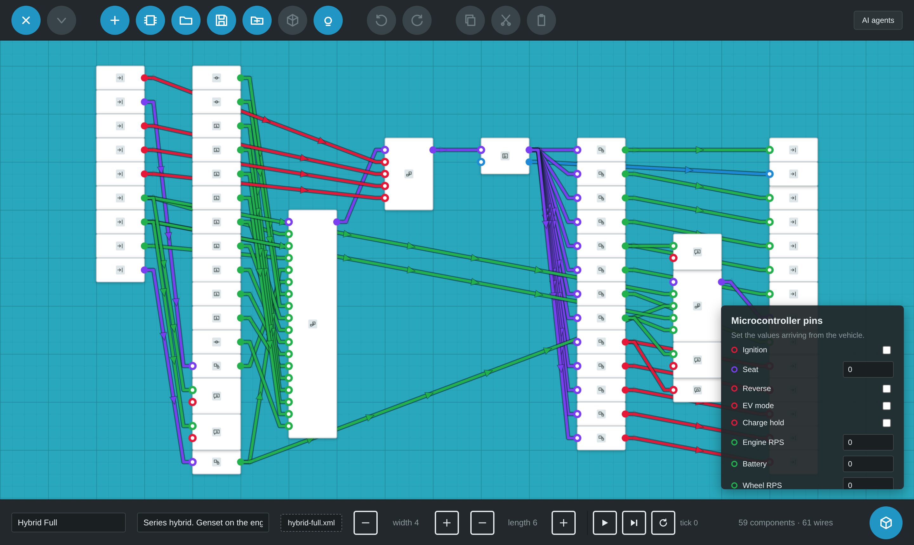

# swmc — Stormworks Microcontroller Editor

[](https://github.com/lavavrik/swmc/actions/workflows/ci.yml)
[](LICENSE)

swmc is a microcontroller editor for Stormworks: Build and Rescue. It operates
in a web browser. It has the same parts as the editor in the game:

- a logic node graph
- a Lua script editor
- a simulation at 60 Hz
- import and export of the game's `.xml` files.

swmc also has a recipe format, a CLI and an MCP server. With these tools, you
or an AI agent can write and test microcontrollers as text.



All of swmc operates in your browser. It does not load files from a CDN.
swmc saves your microcontrollers in the browser (IndexedDB). A build can also
use the [cloud library](server/README.md). In the cloud library, you sign in
and swmc keeps the `.xml` files of each account in Postgres.

> swmc is an unofficial project by a player. Geometa and the other makers of
> Stormworks: Build and Rescue do not support or approve it. swmc contains no
> files from the game.

## Features

- **Logic editor** — You can add each of the game's 60 component types. You
  can move components on a grid and connect their ports with wires. The editor
  refuses a wire between two incompatible ports, and it shows these ports
  dimmed. You can select, delete, copy, cut, paste and duplicate components.
  You can undo and redo each change. You can pan and zoom the view.
- **Scale** — The editor uses the scale of the game. Thus, an imported
  microcontroller has the same layout as in the game.
- **Labels** — The names and settings of components show on their cards. The
  labels keep one size at all zoom levels. The zoom changes only the quantity
  of components that you can see. The lightbulb button turns the labels off.
  Each component has its own symbol, on the workspace and in the menu.
- **Components** — The catalogue has all component types of the game, with
  their numeric type IDs, properties and behaviour. This includes the
  components that keep a state: latches, timers, counters, memory, capacitor,
  blinker, delta and PID. Composite read and composite write components change
  their quantity of ports when you change their channel count, as in the game.
- **Simulation** — swmc calculates the full graph 60 times each second. A
  feedback loop has a delay of one tick. You can set the values at the input
  pins of the microcontroller. The wires then show the signals.
- **Lua** — The script editor is Monaco. It shows completions and help for
  all of the Stormworks Lua API. A Lua interpreter runs `onTick` and `onDraw`.
  A monitor shows the screen output at the screen sizes of the game.
- **Script size** — The character count shows two limits: 4096 for the base
  game and 8192 for the Space DLC. **Minify** removes comments and spaces, and
  makes names shorter. A typical script becomes approximately 38% smaller. The
  minified script shows next to your source. Your source does not change.
- **Video and monitors** — A video signal contains the output of a script. You
  can attach a monitor to each port that has a video signal. To do this,
  double-click the port or use the property panel. You can set the monitor to
  each screen size of the game. The script reads that size from
  `screen.getWidth()`.
- **Monitor display** — swmc draws each monitor pixel by pixel in a 4×5 bitmap
  font. Thus, a 32×32 screen looks the same as in the game. The monitor in the
  script editor is a touchscreen. It sends touch data on the same channels as
  the game.
- **Pins** — The input and output pins of the microcontroller have their own
  panel. In this panel, you can add, name, describe, change the type of,
  reorder and move each pin.
- **Files** — You can import and export Stormworks microprocessor `.xml`
  files. To import a file, drag it onto the workspace or onto the open dialog,
  or select it in a file dialog. swmc keeps a project library in your browser.
  A deployed build can use the cloud library.

## Start swmc

1. Install the dependencies:

   ```bash
   npm install
   ```

2. Start the development server:

   ```bash
   npm run dev
   ```

3. Open http://localhost:5173 in your browser.

| Command                             | Result                                             |
| ----------------------------------- | -------------------------------------------------- |
| `npm run dev`                       | Starts the Vite server on http://localhost:5173    |
| `npm test`                          | Runs the unit tests (Vitest)                       |
| `npm run test:e2e`                  | Runs the interaction tests (Playwright)            |
| `npm run test:server`               | Runs the cloud library tests                       |
| `npm run typecheck`                 | Examines the TypeScript in strict mode             |
| `npm run lint`                      | Runs ESLint                                        |
| `npm run build`                     | Makes a production build                           |
| `npm run mc -- catalog`             | Shows the component catalogue                      |
| `npm run mc -- build <recipe>`      | Makes XML from a recipe; `--open` opens the editor |
| `npm run mc -- open <slug>`         | Opens a saved XML file at `/?open=<slug>`          |
| `npm run mc -- sim <recipe-or-xml>` | Runs ticks; set pins with `--set name=value`       |
| `npm run --silent mcp`              | Starts the MCP server for agents                   |
| `npm run build:mcp`                 | Makes one MCP server file, `dist/swmc-mcp.mjs`     |

## Code layout

The code has strict layers. Each layer imports only from the layers above it
in the list. No layer below `editor/` imports React.

```
src/model/     Graph types, operations and queries. No React, no DOM.
src/library/   The component definitions and the registry.
src/sim/       The tick engine and its values.
src/lua/       The Lua interpreter, the Stormworks API and the screen.
src/io/        The Stormworks XML codec and the project library.
src/recipe/    Recipes with named nodes, automatic layout, and the `mc` CLI.
recipes/       Example recipes. `microcontrollers/` contains the saved XML.
src/editor/    Viewport, cards, wires, interaction, history, store and canvas.
src/ui/        The application frame, toolbar, panels, picker and theme.
server/        The cloud library: a Go API with Postgres and OIDC sign-in.
```

The [design document](docs/superpowers/specs/2026-08-19-stormworks-microcontroller-editor-design.md)
gives the full design. It also tells which parts of the file format are
assumptions.

## Recipes

A recipe is a microcontroller in text form. It uses named nodes and named
ports, not XML. The CLI can build a recipe and run its ticks without a
browser:

```bash
npm run mc -- catalog --json
npm run mc -- build recipes/hybrid-car.yaml --open
npm run mc -- sim recipes/hybrid-car.yaml --set ignition=on --set engine_rps=0 --set throttle=0.7 --set battery=0.5
```

`recipes/throttle-limiter.yaml` is a small example. `recipes/hybrid-full.yaml`
is a full car. An agent must write a recipe, not an `.xml` file. The recipe
format is in `src/recipe/types.ts`.

## Agents (MCP)

Claude Code, Codex and other MCP clients can use the swmc MCP server. With it,
they can build, simulate and save microcontrollers.

In this repository, `.mcp.json` starts the server from the source. The server
saves to `microcontrollers/`. Ask your agent for a microcontroller. The agent
replies with an `?open=` link. The link opens the microcontroller in
`npm run dev`.

To use an agent with a deployed cloud library, do these steps:

1. Sign in to the editor.
2. Click your account.
3. Click **Agent access → Create token**.
4. Paste the two commands that the editor shows into your terminal.

The full guide is in [docs/agents.md](docs/agents.md). The editor shows the
same guide under **AI agents** in the toolbar, or at `/?help=agents`.

## Keys

| Key                                            | Action                                                                       |
| ---------------------------------------------- | ---------------------------------------------------------------------------- |
| Drag                                           | Move the selection                                                           |
| Drag from a port                               | Connect a wire (incompatible ports are dimmed)                               |
| Drag from a connected input                    | Move the wire to a different port, or release it on empty space to remove it |
| Drag on empty space                            | Select an area                                                               |
| Double-click a Lua Script                      | Open the script editor                                                       |
| Double-click a video port                      | Attach a monitor                                                             |
| Two-finger swipe, middle-drag, or space + drag | Pan                                                                          |
| Mouse wheel                                    | Zoom at the pointer                                                          |
| Pinch, or `Ctrl/Cmd` + wheel                   | Zoom at the pointer                                                          |
| `Shift` + wheel                                | Pan to the side                                                              |
| `F`                                            | Show all of the selection, or all of the graph                               |
| `Delete`                                       | Delete the selection                                                         |
| `Ctrl/Cmd` + `Z` / `Shift+Z`                   | Undo / redo                                                                  |
| `Ctrl/Cmd` + `C` / `X` / `V` / `D`             | Copy / cut / paste / duplicate                                               |
| `Ctrl/Cmd` + `A`                               | Select all                                                                   |
| `Escape`                                       | Stop the current action                                                      |

## Connect your Stormworks files

The folder button on the toolbar connects swmc to your installation of the
game. You can connect two folders. They are in different locations:

- **Game files** — Select the Stormworks folder, its `rom` folder, or the
  application. swmc then reads assets from your copy of the game, for example
  the monitor font.
- **Microcontrollers** — Select the folder that contains your designs. Your
  own designs are in `Stormworks/data/microprocessors`. Workshop designs are in
  `steamapps/workshop/content/573090`. swmc searches some levels into the
  folder. It shows each microcontroller that it finds in the open dialog.

swmc reads the files in their location. It does not copy or upload them.

A web page cannot open the folder dialog at a specified path. Thus, the dialog
in swmc shows the paths for your platform, each with a Copy button. To use a
path, do these steps:

1. Click **Copy** next to the path.
2. In the folder dialog, open the path field. Use ⌘⇧G on macOS or Ctrl+L on
   other platforms.
3. Paste the path.

After the first time, the folder dialog opens at the last folder.

This feature uses the File System Access API. Thus, it operates only in a
Chromium browser, for example Chrome, Edge or Arc. Safari and Firefox do not
have a directory picker. In these browsers, swmc uses its replacement font.

### The monitor font

The monitors use the pixel font of the game. swmc reads this font from your
installation when you connect the game folder. This repository does not
contain the game's font. Until you connect the game folder, the monitors use
the replacement 4×5 font of swmc (`src/lua/fallbackFont.ts`). This font has
the same dimensions as the font of the game. Thus, text layouts have the same
dimensions. The game files dialog tells you when swmc uses the replacement
font.

## Known assumptions

The file format comes from the game wiki and the community library
[`sw_mc_lib`](https://github.com/stormworks-utils/sw_mc_lib). A
microcontroller saved by the game was then used to examine it. Some parts are
not confirmed. Each of these assumptions is in one location only:

- the sequence of components in a tick — `src/sim/plan.ts`
- the unit of the map `zoom` argument — `src/lua/prelude.ts`

A microcontroller saved by the game went through import and export with no
change. This test confirmed the position scale and the y direction. The test
also showed some special behaviour of the game:

- The game does not write some attributes.
- The game writes icon and state sections.
- The game puts components edge to edge.

A hand-written test file, `src/io/__fixtures__/game-quirks.xml`, contains
these conditions. The map zoom is the only remaining assumption.

The Lua interpreter is Lua 5.4. The game uses Lua 5.3. Usually, this
difference has no effect on microcontroller scripts. But the two versions are
not fully the same.

## License

[MIT](LICENSE). Stormworks: Build and Rescue and its assets are the property
of their owners. This repository does not contain them.
